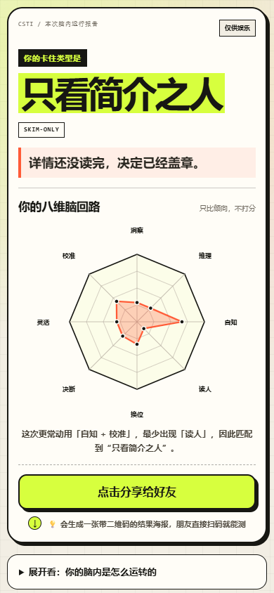

# CSTI 认知风格测试

一个移动端优先的多维认知风格娱乐测试。用户完成 20 道日常情景三选一后，会得到类型名称、八维认知倾向图、行为分析和一张带二维码的结果海报。

> 本测试由 AI 制作，仅供娱乐，不是诊断，也不用于选拔。结果不具心理测量学效度，不代表固定人格或真实能力水平。

国内在线体验（可能失效）：[https://csti-educational-gibbon-d8c5i3aee5a58.webapps.tcloudbase.com](https://csti-educational-gibbon-d8c5i3aee5a58.webapps.tcloudbase.com)



## 功能

- 20 道生活化、低风险的三选一情景题
- 洞察、推理、自知、读人、换位、决断、灵活、校准八个维度
- 最高两维与最低一维组合生成结果类型
- 手机首屏友好的结果布局与八边形雷达图
- 可生成包含二维码的 `1080 × 1500` 分享海报
- 支持系统文件分享，不支持时提供保存图片和长按保存兜底
- 全部计算在浏览器本地完成，不上传答题内容
- 无后端、无第三方运行时依赖

## 本地运行

直接打开 `index.html` 即可。

也可以使用任意静态服务器：

```bash
npx serve .
```

## 构建

项目没有 npm 运行时依赖。构建会清理 `dist/` 并复制静态文件：

```bash
npm run build
```

构建结果位于 `dist/`。

## 项目结构

```text
.
├── index.html
├── styles.css
├── data.js
├── app.js
├── assets/
│   ├── csti-qr.png
│   ├── csti-qr.svg
│   └── preview.png
├── build.mjs
├── package.json
├── README.md
├── CONTRIBUTING.md
└── LICENSE
```

- `data.js`：八维定义、20 道题、20 个类型和分享配置
- `app.js`：答题流程、计分、雷达图、结果海报和朋友对比
- `styles.css`：移动端视觉与响应式布局
- `assets/`：当前演示站点的二维码和 README 预览图

## 计分逻辑

每个选项只记一个主维度。维度得分为：

```text
维度得分 = 该维度被选择的次数 / 该维度在全部选项中出现的次数
```

系统取最高两维和最低一维，优先匹配预设类型；没有完全相同组合时，匹配距离最近的两高一低。八维跨度过小时进入兜底类型“无短板之人”。

该算法用于娱乐性类型匹配，不是经过验证的心理测量模型。

## 部署

项目可以直接部署到任意静态托管平台：

- GitHub Pages
- Cloudflare Pages
- Netlify
- Vercel 静态站点
- 腾讯云 CloudBase

仓库包含 GitHub Pages workflow。启用 Pages 后，推送到 `main` 会自动构建并发布 `dist/`。

当前二维码和 `data.js` 中的 `shareUrl` 指向作者的线上演示地址。Fork 后若要部署自己的版本，请同步替换：

```js
shareUrl: "https://your-domain.example",
shareQrDataUrl: "data:image/png;base64,..."
```

并重新生成 `assets/csti-qr.png`、`assets/csti-qr.svg`。

## 隐私

- 不要求登录
- 不收集姓名、联系方式或其他个人资料
- 答题仅在浏览器中计算
- 分享 URL 只包含类型 ID 和量化后的八维位置，不包含原始答案

## 适用边界

这是一个传播型、趣味性自我探索产品，不是临床量表、认知能力测验、招聘工具或关系判断工具。请勿将结果用于诊断、选拔、歧视、骚扰或对他人作确定性评价。

## 贡献

提交问题、类型文案或交互改动前，请阅读 [CONTRIBUTING.md](CONTRIBUTING.md)。

## License

[MIT](LICENSE)
